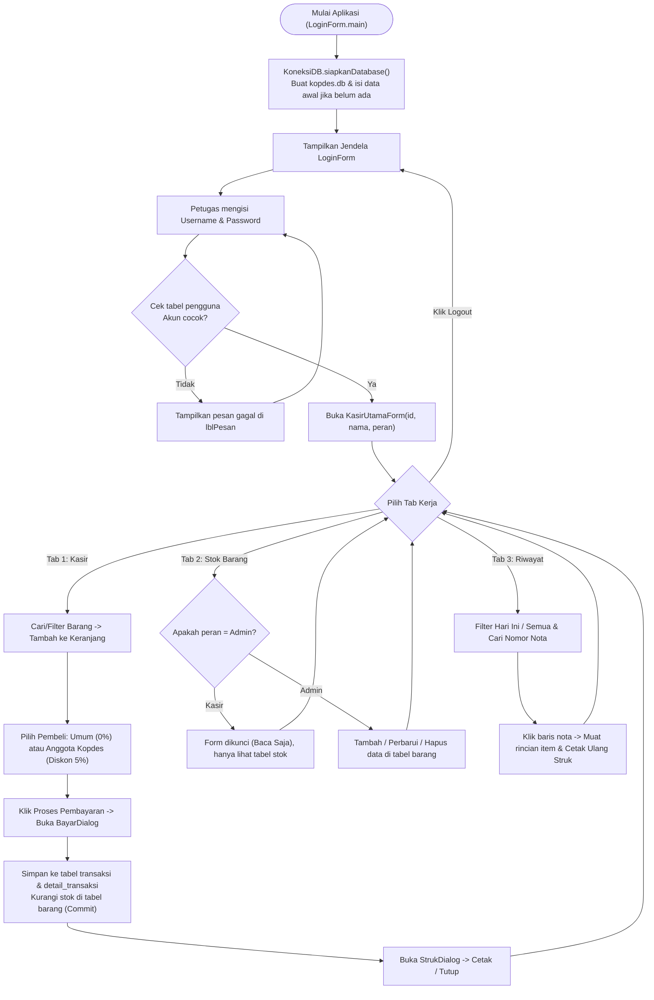
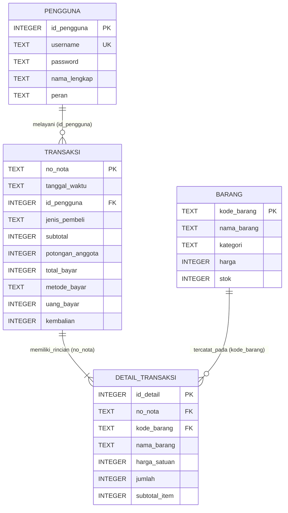

# Panduan Laporan Kuliah, Database, dan Bedah Kode: Retail Kopdes

Dokumen ini disusun khusus sebagai pegangan Anda untuk dua keperluan utama:
1. **Menyusun laporan tertulis tugas kuliah** (lengkap dengan tabel alur kerja Input-Proses-Output, kamus data 4 tabel, diagram alur, dan cara mengambil gambar ER Diagram dari DBeaver).
2. **Menghadapi demonstrasi dan tanya-jawab dosen di kelas** (memahami isi setiap baris kode pada kelima file Java sehingga Anda dapat menjelaskan cara kerjanya dengan lancar menggunakan bahasa sendiri).

---

## Bagian 1: Arsitektur & Tabel Alur Kerja Aplikasi (Bahan Laporan)

### 1.1 Ringkasan Struktur Program
Aplikasi **Retail Kopdes** sengaja dibangun dengan arsitektur ringkas **5 kelas Java** di dalam satu paket `com.kopdes` agar alur datanya lurus dan mudah ditelusuri dari tampilan antarmuka langsung ke database:

| No | Nama File | Jenis Kelas | Peran Utama di Aplikasi |
| :- | :--- | :--- | :--- |
| 1 | `KoneksiDB.java` | Kelas Pembantu (`Utility`) | Membuka koneksi ke `kopdes.db`, membuat 4 tabel otomatis, mengisi data awal, memformat angka Rupiah (`long`), menghitung diskon 5%, dan memuat logo PNG. |
| 2 | `LoginForm.java` + `.form` | `JFrame` (Jendela Awal) | Titik mulai aplikasi (`main`), memasang tema visual FlatLaf, memvalidasi username & password ke tabel `pengguna`, lalu membuka jendela kasir sesuai peran. |
| 3 | `KasirUtamaForm.java` + `.form` | `JFrame` (Jendela Utama) | Jendela kerja 3 tab: **Tab 1 Transaksi Kasir**, **Tab 2 Data & Stok Barang**, dan **Tab 3 Riwayat Penjualan**, lengkap dengan jam digital dan tombol Logout. |
| 4 | `BayarDialog.java` + `.form` | `JDialog` (Dialog Modal) | Menangani pembayaran **Tunai** atau **QRIS**, menghitung uang kembalian otomatis, serta menyimpan nota & memotong stok secara atomik ke database. |
| 5 | `StrukDialog.java` + `.form` | `JDialog` (Dialog Modal) | Menyusun teks struk belanja rata kolom menggunakan huruf `Monospaced` dan mengirimkannya ke printer atau PDF. |

### 1.2 Diagram Alur Utama Aplikasi (Flowchart)

### 1.3 Tabel Alur Kerja 4 Fitur Utama (Siap Salin ke Laporan Word/Docs)

#### A. Tabel Alur Kerja Fitur 1: Login Petugas
| Langkah | Aktor | Input / Aksi | Proses di Kode Program | Output Antarmuka & Tabel Database |
| :-: | :--- | :--- | :--- | :--- |
| 1 | Sistem | Aplikasi dijalankan (`LoginForm.main`) | Memasang tampilan `FlatLightLaf`, lalu memanggil `KoneksiDB.siapkanDatabase()` untuk memastikan `kopdes.db` siap. | File `kopdes.db` terbentuk otomatis; jendela `LoginForm` tampil di tengah layar. |
| 2 | Petugas | Mengetik *username* dan *password*, lalu menekan `Enter` atau klik **Masuk Aplikasi** | Metode `jalankanProsesLogin()` memeriksa apakah kotak input kosong, lalu memanggil `cekLoginDatabase(user, pass)`. | Jika kosong, muncul peringatan merah tanpa mengakses database. |
| 3 | Sistem | Menjalankan query `SELECT` berparameter | Mengirim `SELECT id_pengguna, nama_lengkap, peran FROM pengguna WHERE username = ? AND password = ?`. | Membaca baris akun yang cocok dari tabel `pengguna`. |
| 4 | Sistem | Memeriksa hasil query | Jika `null`, menampilkan pesan kesalahan. Jika ditemukan, membuka `new KasirUtamaForm(id, nama, peran)` dan menutup `LoginForm`. | Masuk ke jendela utama kasir dengan nama petugas dan peran tertera di header atas. |

#### B. Tabel Alur Kerja Fitur 2: Transaksi Kasir & Cetak Struk
| Langkah | Aktor | Input / Aksi | Proses di Kode Program | Output Antarmuka & Tabel Database |
| :-: | :--- | :--- | :--- | :--- |
| 1 | Kasir | Mengetik nama/kode di kotak cari atau memilih kategori | `DocumentListener` pada `txtCariBarang` memanggil `muatTabelKatalog()` dengan query `SELECT ... FROM barang WHERE ...`. | Tabel katalog kiri langsung menyaring daftar barang dari tabel `barang`. |
| 2 | Kasir | Klik dua kali baris barang atau atur jumlah & klik **+ Tambah ke Keranjang** | `tambahAtauPerbaruiItemKeranjang()` mengecek sisa stok melalui `hitungJumlahBaruKeranjang()` agar tidak melebihi stok tersedia. | Barang masuk ke `tblKeranjang` di sisi kanan; jika melebihi stok, muncul dialog peringatan. |
| 3 | Kasir | Memilih radio **Umum** atau **Anggota Kopdes (Diskon 5%)** | `perbaruiTampilanKeranjang()` memanggil `KoneksiDB.hitungPotonganAnggota(subtotal, adalahAnggota)` dengan tipe `long`. | Kotak ringkasan hijau memperbarui nilai Subtotal, Potongan 5%, dan Total Bayar secara langsung. |
| 4 | Kasir | Klik **Proses Pembayaran (F8)**, memilih **Tunai** atau **QRIS**, lalu klik **Selesaikan & Cetak Struk** | `BayarDialog.simpanTransaksiKeDatabase()` mematikan auto-commit, menyimpan header nota, menyimpan tiap item, mengurangi stok, lalu `conn.commit()`. | Baris baru tercatat di `transaksi` & `detail_transaksi`, kolom `stok` di `barang` berkurang, dan `StrukDialog` terbuka. |

#### C. Tabel Alur Kerja Fitur 3: Kelola Data & Stok Barang (CRUD)
| Langkah | Aktor | Input / Aksi | Proses di Kode Program | Output Antarmuka & Tabel Database |
| :-: | :--- | :--- | :--- | :--- |
| 1 | Sistem | Saat `KasirUtamaForm` dibuka | `aturHakAksesPeran()` mengecek apakah `peran` bernilai `"Admin"`. | Jika `Kasir`, seluruh kotak isian dan tombol CRUD dinonaktifkan (mode baca-saja). Jika `Admin`, form aktif penuh. |
| 2 | Admin | Mengisi Kode, Nama, Kategori, Harga, Stok lalu klik **Simpan Baru** | `simpanBarangBaru()` memvalidasi input, menolak kode kembar, lalu menjalankan `INSERT INTO barang VALUES (?, ?, ?, ?, ?)`. | Barang baru tersimpan di tabel `barang` dan langsung muncul di tabel stok maupun katalog kasir. |
| 3 | Admin | Klik salah satu baris tabel, mengubah harga/stok, lalu klik **Perbarui Data** | `isiFormDariBarisStokTerpilih()` menyalin data ke form; `ubahDataBarang()` menjalankan `UPDATE barang SET ... WHERE kode_barang = ?`. | Data barang pada tabel `barang` diperbarui beserta indikator status stok (*Tersedia* / *Stok Menipis* / *Habis*). |
| 4 | Admin | Klik baris barang lalu klik **Hapus Barang** | `hapusDataBarang()` mengecek `SELECT COUNT(*) FROM detail_transaksi WHERE kode_barang = ?` sebelum menjalankan `DELETE`. | Jika barang belum pernah terjual, data terhapus. Jika sudah tercatat di nota lama, sistem menolak penghapusan dan menyarankan ubah stok jadi `0`. |

#### D. Tabel Alur Kerja Fitur 4: Riwayat Penjualan
| Langkah | Aktor | Input / Aksi | Proses di Kode Program | Output Antarmuka & Tabel Database |
| :-: | :--- | :--- | :--- | :--- |
| 1 | Petugas | Membuka tab **Riwayat Penjualan**, memilih periode (**Hari Ini** / **Semua**), atau mengetik nomor nota | `muatTabelRiwayat()` menjalankan query `SELECT ... FROM transaksi t JOIN pengguna p ON t.id_pengguna = p.id_pengguna`. | Tabel atas menampilkan daftar nota, serta label rekap menghitung total nota dan pemasukan Rupiah. |
| 2 | Petugas | Mengklik salah satu baris nomor nota pada tabel atas | `muatDetailRiwayatTerpilih()` menjalankan `SELECT ... FROM detail_transaksi WHERE no_nota = ?`. | Tabel bawah menampilkan rincian barang, harga satuan, jumlah beli, dan subtotal untuk nota tersebut. |
| 3 | Petugas | Mengklik tombol **Buka / Cetak Ulang Struk** | `btnBukaStrukActionPerformed()` mengambil data nota & rinciannya lalu memanggil `StrukDialog.susunTeksStruk(...)`. | Jendela `StrukDialog` terbuka kembali persis seperti saat transaksi selesai dan siap dicetak ulang. |

---

## Bagian 2: Perancangan Database SQLite & Kamus Data

### 2.1 Diagram Relasi Tabel (ER Diagram)

### 2.2 Kamus Data Keempat Tabel

#### 1. Tabel `pengguna` (Menyimpan akun login petugas koperasi)
| Nama Kolom | Tipe Data SQLite | Kunci / Aturan | Keterangan |
| :--- | :--- | :--- | :--- |
| `id_pengguna` | `INTEGER` | `PRIMARY KEY AUTOINCREMENT` | Nomor urut unik identitas petugas. |
| `username` | `TEXT` | `NOT NULL UNIQUE` | Nama akun untuk login (contoh: `admin`, `kasir`). |
| `password` | `TEXT` | `NOT NULL` | Kata sandi login (disimpan teks biasa khusus lingkup pembelajaran agar transparan saat dicek di DB Browser). |
| `nama_lengkap` | `TEXT` | `NOT NULL` | Nama lengkap petugas yang dicetak pada struk belanja. |
| `peran` | `TEXT` | `NOT NULL` | Hak akses petugas: `Admin` atau `Kasir`. |

#### 2. Tabel `barang` (Menyimpan katalog produk dan sisa stok)
| Nama Kolom | Tipe Data SQLite | Kunci / Aturan | Keterangan |
| :--- | :--- | :--- | :--- |
| `kode_barang` | `TEXT` | `PRIMARY KEY` | Kode unik produk koperasi (contoh: `BRG001`). |
| `nama_barang` | `TEXT` | `NOT NULL` | Nama produk yang tampil di katalog dan struk. |
| `kategori` | `TEXT` | `NOT NULL` | Kelompok barang (`Sembako`, `Minuman`, `Kebutuhan Rumah`, `Lainnya`). |
| `harga` | `INTEGER` | `NOT NULL CHECK (harga >= 0)` | Harga jual satuan dalam Rupiah bulat 64-bit (`long` di Java). |
| `stok` | `INTEGER` | `NOT NULL CHECK (stok >= 0)` | Sisa stok fisik barang yang tersedia untuk dijual. |

#### 3. Tabel `transaksi` (Menyimpan kepala/header setiap nota penjualan)
| Nama Kolom | Tipe Data SQLite | Kunci / Aturan | Keterangan |
| :--- | :--- | :--- | :--- |
| `no_nota` | `TEXT` | `PRIMARY KEY` | Nomor nota unik berformat `KPD-YYYYMMDD-NNN` (contoh: `KPD-20261031-001`). |
| `tanggal_waktu` | `TEXT` | `NOT NULL` | Waktu transaksi disimpan berformat `yyyy-MM-dd HH:mm:ss`. |
| `id_pengguna` | `INTEGER` | `NOT NULL FOREIGN KEY` | Mengacu ke `pengguna(id_pengguna)` sebagai kasir pencatat nota. |
| `jenis_pembeli` | `TEXT` | `NOT NULL` | Kategori pembeli: `Umum` atau `Anggota Kopdes`. |
| `subtotal` | `INTEGER` | `NOT NULL` | Total harga kotor sebelum potongan anggota. |
| `potongan_anggota` | `INTEGER` | `NOT NULL` | Nilai diskon 5% dalam Rupiah (`0` jika pembeli Umum). |
| `total_bayar` | `INTEGER` | `NOT NULL` | Tagihan bersih setelah dikurangi potongan (`subtotal - potongan_anggota`). |
| `metode_bayar` | `TEXT` | `NOT NULL` | Cara pembayaran: `Tunai` atau `QRIS`. |
| `uang_bayar` | `INTEGER` | `NOT NULL` | Nominal uang yang diterima dari pembeli. |
| `kembalian` | `INTEGER` | `NOT NULL` | Selisih kembalian (`uang_bayar - total_bayar`). |

#### 4. Tabel `detail_transaksi` (Menyimpan daftar barang per nomor nota)
| Nama Kolom | Tipe Data SQLite | Kunci / Aturan | Keterangan |
| :--- | :--- | :--- | :--- |
| `id_detail` | `INTEGER` | `PRIMARY KEY AUTOINCREMENT` | Nomor urut baris rincian item. |
| `no_nota` | `TEXT` | `NOT NULL FOREIGN KEY` | Mengacu ke `transaksi(no_nota)`. |
| `kode_barang` | `TEXT` | `NOT NULL FOREIGN KEY` | Mengacu ke `barang(kode_barang)`. |
| `nama_barang` | `TEXT` | `NOT NULL` | Salinan nama barang saat transaksi terjadi agar riwayat nota tetap akurat walau nama barang diubah di kemudian hari. |
| `harga_satuan` | `INTEGER` | `NOT NULL` | Salinan harga satuan saat transaksi terjadi. |
| `jumlah` | `INTEGER` | `NOT NULL CHECK (jumlah > 0)` | Banyaknya unit barang yang dibeli. |
| `subtotal_item` | `INTEGER` | `NOT NULL` | Hasil kali `harga_satuan * jumlah`. |

### 2.3 Cara Mengedit Isi Database di DB Browser for SQLite
1. Jalankan aplikasi minimal satu kali agar file `kopdes.db` terbentuk di folder utama proyek (`coba baru/kopdes.db`).
2. Buka aplikasi **DB Browser for SQLite**.
3. Klik tombol **Open Database** di kiri atas, pilih file `kopdes.db`, lalu klik **Open**.
4. Klik tab **Browse Data**, lalu pilih tabel pada dropdown **Table:** (misalnya `barang` atau `pengguna`).
5. Klik dua kali sel mana pun untuk mengubah nilainya secara langsung, atau klik **New Record** untuk menambah baris.
6. **Penting:** Klik tombol **Write Changes** (Ctrl+S) di bilah atas agar perubahan benar-benar tersimpan ke file `kopdes.db` dan tidak mengunci transaksi dari aplikasi Java.

### 2.4 Cara Mengekspor Gambar ER Diagram Otomatis di DBeaver (Untuk Laporan)
1. Buka aplikasi **DBeaver**.
2. Klik menu **Database -> New Database Connection**, pilih **SQLite**, lalu klik **Next**.
3. Klik tombol **Browse...** di sebelah kanan kolom *Path*, pilih file `coba baru/kopdes.db`, lalu klik **Finish**.
4. Di panel kiri (*Database Navigator*), bentangkan koneksi `kopdes.db` -> klik dua kali **Tables**.
5. Pada jendela kanan yang terbuka, klik tab **ER Diagram** di bagian bawah/atas. Keempat tabel beserta garis panah `FOREIGN KEY`-nya akan langsung tergambar otomatis!
6. Klik kanan pada area kosong diagram -> pilih **Save diagram in external format (PNG, GIF, BMP)** -> simpan sebagai gambar `.png` lalu tempelkan langsung ke dokumen laporan kuliah Anda.

---

## Bagian 3: Panduan Demonstrasi di Apache NetBeans & Logo Kustom

### 3.1 Membuka Tab Design (Drag-and-Drop) di Apache NetBeans
Saat dosen atau teman sekelas meminta melihat rancangan antarmuka di NetBeans:
1. Buka **Apache NetBeans**, klik **File -> Open Project**, lalu pilih folder `coba baru`.
2. Bentangkan **Source Packages -> `com.kopdes`**. Anda akan melihat 5 file dengan ikon bersih:
   - `KoneksiDB.java` (ikon kelas Java biasa karena murni logika database).
   - `LoginForm.java`, `KasirUtamaForm.java`, `BayarDialog.java`, dan `StrukDialog.java` (berikon formulir JFrame/JDialog karena masing-masing memiliki pasangan file `.form`).
3. Klik dua kali `KasirUtamaForm.java`. Di bagian atas area kode terdapat tombol **Source** dan **Design**:
   - Klik **Design** untuk memperlihatkan susunan komponen visual lengkap di *Navigator* dan *Properties* NetBeans.
   - Klik **Source** untuk memperlihatkan kode programnya.

> **Catatan Penting Saat Mengedit di NetBeans:**  
> Di dalam file `.java` terdapat blok bertanda `//GEN-BEGIN:initComponents` sampai `//GEN-END:initComponents` (tampil berlatar abu-abu di NetBeans). Blok itu dihasilkan otomatis dari file `.form`. Jika ingin menggeser posisi tombol atau mengubah teks label di NetBeans, lakukan lewat tab **Design**, jangan mengedit paksa blok `//GEN-BEGIN` dengan teks editor biasa agar pasangan `.form` dan `.java` tetap sinkron.

### 3.2 Urutan Skenario Demo 5 Menit di Depan Dosen
1. **Tunjukkan Struktur & Tab Design (1 menit):** Perlihatkan hanya ada 5 file `.java` yang rapi di NetBeans, lalu buka tab **Design** pada `LoginForm` dan `KasirUtamaForm`.
2. **Demo Validasi Login & Hak Akses Kasir (1 menit):** Tekan `F6` (Run). Coba klik **Masuk Aplikasi** dengan password salah untuk menunjukkan validasi. Lalu masuk sebagai `kasir` / `kasir123` dan buka **Tab 2 (Data & Stok Barang)** untuk memperlihatkan bahwa kasir dikunci dalam mode baca-saja. Klik **Logout**.
3. **Demo Transaksi Anggota & Pembayaran (1,5 menit):** Masuk sebagai `admin` / `admin123`. Cari barang `"Beras"`, klik dua kali agar masuk keranjang. Ubah radio pembeli ke **Anggota Kopdes (Diskon 5%)** untuk menunjukkan potongan otomatis. Tekan **Proses Pembayaran (F8)**, klik tombol cepat **Rp 100.000** (perlihatkan kembalian otomatis), ubah sempat ke **QRIS** untuk memperlihatkan kotak QR, kembalikan ke **Tunai**, lalu klik **Selesaikan & Cetak Struk**.
4. **Demo CRUD Barang & Proteksi Relasi (1 menit):** Pindah ke **Tab 2**, tambahkan 1 barang contoh baru lalu perbarui stoknya. Kemudian coba hapus `BRG001` (Beras yang baru saja dibeli) untuk memamerkan proteksi `FOREIGN KEY` yang menolak penghapusan barang bersejarah nota.
5. **Demo Riwayat Penjualan (0,5 menit):** Pindah ke **Tab 3**, klik baris nota yang baru dibuat untuk menampilkan rincian barang di tabel bawah, lalu klik **Buka / Cetak Ulang Struk**.

---

## Bagian 4: Bedah Kode Baris demi Baris (5 File Java)

Bagian ini menjelaskan isi setiap file dari atas ke bawah dengan bahasa sehari-hari supaya jika dosen menunjuk baris mana pun dan bertanya *"Ini buat apa?"*, Anda langsung paham jawabannya.

---

### 4.1 Bedah File 1: `KoneksiDB.java` (263 Baris)
File ini adalah **"jantung penghubung database dan alat bantu berhitung Rupiah"** yang dipanggil oleh keempat form lainnya.

- **Baris 1 - 19 (`package` & `import`):** Mendeklarasikan paket `com.kopdes` dan memanggil pustaka bawaan Java (`java.sql.*` untuk database JDBC, `java.awt.Color` & `Image` untuk warna dan logo, `DecimalFormat` untuk pemisah titik ribuan Indonesia).
- **Baris 23 - 34 (Konstanta Warna & Diskon):** Menyimpan seluruh palet warna aplikasi di satu tempat (`WARNA_HEADER` hijau tua `#065F46`, `WARNA_LATAR` mint lembut `#F0FDF4`, `WARNA_TOMBOL_BAYAR` oranye bata `#C2410C`, `WARNA_BAHAYA` merah `#B91C1C`) serta konstanta `PERSEN_DISKON_ANGGOTA = 5`. Tujuannya agar warna seragam di semua jendela dan tidak perlu mengetik angka RGB berulang-ulang.
- **Baris 36 - 42 (`lokasiDatabase` & `aturLokasiDatabase`):**
  - `lokasiDatabase` secara bawaan menunjuk ke file `"kopdes.db"` di folder proyek. Metode `aturLokasiDatabase()` disediakan agar pengujian otomatis JUnit bisa memakai file database sementara tanpa mengotori data asli Anda.
- **Baris 44 - 61 (`ambilKoneksi()` & `aktifkanForeignKey`):**
  - Membuka jalur komunikasi ke file SQLite melalui `DriverManager.getConnection("jdbc:sqlite:" + lokasiDatabase)`.
  - Menjalankan perintah penting `PRAGMA foreign_keys = ON;` melalui `aktifkanForeignKey()`. Pada SQLite, penjaga relasi antar tabel (`FOREIGN KEY`) secara bawaan mati setiap kali koneksi baru dibuka, sehingga baris ini wajib dipanggil agar relasi tabel `transaksi`, `barang`, dan `detail_transaksi` benar-benar dijaga. Jika pengaktifan PRAGMA gagal, koneksi langsung ditutup kembali agar file `kopdes.db` tidak terkunci.
- **Baris 63 - 119 (`siapkanDatabase()`):**
  - Menggunakan blok `try (Connection conn = ...; Statement st = ...)` (*try-with-resources*) supaya koneksi database otomatis ditutup rapi setelah selesai dipakai.
  - Menjalankan 4 perintah `CREATE TABLE IF NOT EXISTS` untuk membuat tabel `pengguna`, `barang`, `transaksi`, dan `detail_transaksi`. Kata `IF NOT EXISTS` menjamin jika tabel sudah ada, data lama Anda **tidak akan tertimpa atau hilang**.
  - Memanggil `isiDataAwalJikaKosong(conn)`.
- **Baris 121 - 171 (`isiDataAwalJikaKosong`):**
  - Mengecek jumlah isi tabel `pengguna` dan `barang` menggunakan `SELECT COUNT(*)`. Hanya jika jumlahnya `0` (database benar-benar baru pertama kali dibuat), program memasukkan 2 akun bawaan (`admin` & `kasir`) serta 10 produk awal koperasi desa memakai `executeBatch()`.
- **Baris 173 - 201 (`formatRupiah` & `parseNominalRupiah`):**
  - `formatRupiah(long nominal)` menggunakan `DecimalFormat("#,###")` dengan pemisah titik `.` untuk mengubah angka bulat `long` menjadi teks `"Rp 68.000"` (atau `"-Rp 5.000"` jika negatif).
  - `parseNominalRupiah(String teksInput)` adalah kebalikannya: membuang tulisan `"Rp"`, spasi, dan tanda titik `.` sehingga ketikan pengguna seperti `"50.000"` atau `"Rp 50.000"` tetap aman dibaca menjadi angka `50000L`. Jika ketikan mengandung huruf tidak valid atau tanda minus, mengembalikan `-1L` sebagai penanda input salah.
- **Baris 203 - 208 (`hitungPotonganAnggota`):**
  - Jika bukan anggota, mengembalikan `0L`. Jika anggota, menghitung `Math.round(subtotal * (PERSEN_DISKON_ANGGOTA / 100.0))` agar pembulatan 5% selalu utuh dalam Rupiah terdekat tanpa sisa koma desimal.
- **Baris 210 - 234 (`buatNomorNotaBaru`):**
  - Membuat kode nota otomatis berformat `KPD-YYYYMMDD-NNN` (misalnya `KPD-20261031-001`). Caranya mencari seluruh nota pada tanggal hari ini (`SELECT no_nota FROM transaksi WHERE no_nota LIKE ?`), mengambil urutan angka tertinggi (aman melampaui 999 nota sehari maupun bila ada nota manual), lalu menambah `+ 1`.
- **Baris 236 - 262 (`muatLogoOpsional`):**
  - Mencari file gambar PNG di dalam classpath `/logo/` atau folder `src/main/resources/logo/`. Jika ketemu, ukurannya dihaluskan dengan `SCALE_SMOOTH`. Jika file gambar belum Anda buat, metode ini mengembalikan `null` dengan aman sehingga aplikasi otomatis memakai teks `[RK]` tanpa error.

---

### 4.2 Bedah File 2: `LoginForm.java` (301 Baris)
File ini adalah **pintu gerbang aplikasi** sekaligus tempat fungsi `public static void main` berada.

- **Baris 15 - 58 (Konstruktor `LoginForm()` & `terapkanIdentitasDanLogo()`):**
  - Memanggil `initComponents()` untuk membangun tata letak komponen NetBeans, lalu mewarnai header hijau tua, kartu putih, dan tombol masuk sesuai palet `KoneksiDB`.
  - Memeriksa apakah ada `logo-ikon.png` dan `logo-login.png`. Jika belum ada, label menampilkan teks `[RK]`.
  - Menghubungkan `lblUsername.setLabelFor(txtUsername)` untuk aksesibilitas keyboard, memasang kursor tangan pada tombol, dan mengaktifkan `getRootPane().setDefaultButton(btnMasuk)` supaya menekan tombol `Enter` di mana saja langsung mengeksekusi tombol **Masuk Aplikasi**.
- **Baris 60 - 82 (`cekLoginDatabase`):**
  - Metode statis yang menerima `username` dan `password`. Jika kosong, langsung mengembalikan `null`.
  - Menjalankan `PreparedStatement` dengan query:
    `SELECT id_pengguna, nama_lengkap, peran FROM pengguna WHERE username = ? AND password = ?`
  - Tanda tanya `?` diisi memakai `ps.setString(1, ...)` dan `ps.setString(2, ...)`. Jika cocok, mengembalikan array 3 elemen `{id, nama_lengkap, peran}`.
- **Baris 84 - 124 (`jalankanProsesLogin()`):**
  - Mengambil teks dari `txtUsername` dan `new String(txtPassword.getPassword())`.
  - Jika salah satu belum diisi, menampilkan pesan merah di `lblPesan` dan mengarahkan kursor fokus ke kotak yang kosong.
  - Jika login cocok, membuat jendela `new KasirUtamaForm(idPengguna, namaLengkap, peran)` lalu menutup jendela login dengan `dispose()`.
  - Jika salah, memblok teks sandi (`selectAll()`) dan menampilkan pesan `"Gagal masuk: Username atau kata sandi tidak sesuai."`.
- **Baris 128 - 264 (`initComponents()`):** Blok kode otomatis NetBeans yang menata panel header, kartu login putih di tengah, kotak input, dan tombol menggunakan `GroupLayout`.
- **Baris 266 - 272 (`btnMasukActionPerformed` & `btnKeluarActionPerformed`):** Penangan klik tombol Masuk (memanggil `jalankanProsesLogin()`) dan Keluar (`System.exit(0)`).
- **Baris 274 - 286 (`main(String[] args)`):**
  - Titik awal saat aplikasi dijalankan. Memasang tema modern `FlatLightLaf.setup()`, mengatur lengkungan sudut tombol (`arc = 8`) dan ketebalan garis fokus keyboard (`focusWidth = 2`), memanggil `KoneksiDB.siapkanDatabase()`, lalu menampilkan `LoginForm` di jalur antarmuka Swing (`EventQueue.invokeLater`).

---

### 4.3 Bedah File 3: `KasirUtamaForm.java` (1787 Baris)
Meskipun jumlah barisnya paling panjang karena memuat tata letak NetBeans untuk 3 tab sekaligus (`initComponents` memakan baris 716-1402), logika intinya terbagi rapi menjadi **4 bagian mudah**:

#### A. Inisialisasi, Hak Akses, & Jam Digital (Baris 31 - 277)
- **Baris 33 - 40 (Variabel Kelas):** Menyimpan identitas petugas yang sedang login (`idPengguna`, `namaLengkap`, `peran`), daftar belanjaan sementara di memori `daftarKeranjang` (`List<String[]>`), dan `timerJam`.
- **Baris 44 - 55 (Konstruktor):** Membangun komponen, menyiapkan warna, lalu memuat isi awal ketiga tabel (`muatTabelKatalog()`, `muatTabelStokBarang()`, `muatTabelRiwayat()`).
- **Baris 161 - 180 (`aturHakAksesPeran()`):** Mengecek `"Admin".equalsIgnoreCase(peran)`. Jika yang login adalah `Kasir`, seluruh kotak teks dan tombol simpan/ubah/hapus di Tab 2 dimatikan (`setEnabled(false)`) dan label info berubah menjadi keterangan mode baca-saja.
- **Baris 182 - 246 (`pasangPendengarInteraksi()`):**
  - Memasang `DocumentListener` pada `txtCariBarang` dan `txtCariNota` agar setiap huruf yang diketik langsung menyaring isi tabel secara seketika tanpa perlu menekan tombol Cari.
  - Memasang `MouseAdapter` klik dua kali (`e.getClickCount() == 2`) pada `tblKatalog` agar kasir bisa memasukkan barang ke keranjang dengan cepat.
  - Memasang `ListSelectionListener` pada `tblStokBarang` (klik baris langsung mengisi form edit) dan `tblRiwayat` (klik nomor nota langsung memuat rincian barang di tabel bawah).
- **Baris 248 - 277 (`pasangPintasanKeyboard` & `mulaiJamDigital`):**
  - Mendaftarkan tombol `F2` untuk langsung melompat fokus ke kotak pencarian barang dan `F8` untuk membuka dialog pembayaran.
  - Menjalankan `javax.swing.Timer` setiap `1000` milidetik (1 detik) untuk memperbarui jam digital di pojok kanan atas header.

#### B. Logika Tab 1: Katalog & Keranjang Kasir (Baris 279 - 289 & 374 - 559)
- **`hitungJumlahBaruKeranjang` (Baris 279 - 289):** Menjumlahkan qty barang yang sudah ada di keranjang dengan tambahan baru, lalu membandingkannya terhadap `stokTersedia`. Jika melebihi sisa stok, melempar `IllegalArgumentException` agar kasir tidak pernah menjual barang melebihi stok gudang.
- **`muatTabelKatalog` (Baris 374 - 427):** Menyusun query `SELECT` dinamis berdasarkan kategori yang dipilih dan kata kunci pencarian (`LOWER(kode_barang) LIKE ? OR LOWER(nama_barang) LIKE ?`), lalu menampilkan jumlah barang yang ditemukan di `lblStatusKatalog`.
- **`tambahAtauPerbaruiItemKeranjang` (Baris 458 - 484):** Jika barang yang dipilih sudah ada di `daftarKeranjang`, cukup menambah kolom qty dan menghitung ulang subtotal barisnya; jika belum ada, menambahkan baris baru ke keranjang.
- **`perbaruiTampilanKeranjang` (Baris 486 - 528):** Menggambar ulang `tblKeranjang`, menjumlahkan `subtotal`, mengecek radio `rbAnggota.isSelected()` untuk menghitung potongan 5%, menampilkan Total Bayar, serta mematikan tombol aksi keranjang & tombol Bayar saat keranjang kosong.
- **`bukaDialogPembayaran` (Baris 530 - 559):** Membuka `BayarDialog` secara modal. Jika transaksi tuntas (`dialog.apakahTransaksiBerhasil()`), otomatis mengosongkan keranjang dan menyegarkan ulang tabel katalog, tabel stok, dan tabel riwayat supaya angka sisa stok terbaru langsung terlihat.

#### C. Logika Tab 2: CRUD Data & Stok Barang (Baris 291 - 372 & 561 - 611)
- **`simpanBarangBaru` (Baris 291 - 312):** Memvalidasi bahwa kode/nama tidak kosong dan harga/stok tidak negatif, mengecek apakah `kode_barang` sudah dipakai, lalu menjalankan `INSERT INTO barang`.
- **`ubahDataBarang` (Baris 314 - 329):** Menjalankan `UPDATE barang SET nama_barang = ?, kategori = ?, harga = ?, stok = ? WHERE kode_barang = ?`.
- **`hapusDataBarang` (Baris 331 - 354):** Mengecek terlebih dahulu ke tabel `detail_transaksi` apakah barang ini sudah pernah masuk ke nota penjualan. Jika `COUNT(*) > 0`, program menolak penghapusan dengan pesan sopan dan menyarankan mengubah stok menjadi `0` supaya riwayat nota masa lalu tidak rusak.
- **`muatTabelStokBarang` (Baris 561 - 586):** Memuat seluruh daftar barang dan memberi label status otomatis: `Habis (0)` jika stok 0, `Stok Menipis` jika stok <= 5, atau `Tersedia`.

#### D. Logika Tab 3: Riwayat Penjualan & Cetak Ulang (Baris 613 - 712 & 1622 - 1680)
- **`muatTabelRiwayat` (Baris 613 - 678):** Menggabungkan (`JOIN`) tabel `transaksi` dengan tabel `pengguna` agar yang tampil di kolom kasir adalah **nama lengkap petugas**, bukan sekadar angka `id_pengguna`. Sekaligus menjumlahkan `jumlahNota` dan `totalOmset` (`long`) sesuai filter yang aktif.
- **`muatDetailRiwayatTerpilih` (Baris 680 - 712):** Mengambil daftar item dari `detail_transaksi` berdasarkan `no_nota` yang sedang diklik di tabel atas.
- **`btnBukaStrukActionPerformed` (Baris 1622 - 1680):** Mengambil kembali data nota beserta rincian itemnya dari database, menyusun teks struk melalui `StrukDialog.susunTeksStruk(...)`, lalu menampilkan `StrukDialog`.

---

### 4.4 Bedah File 4: `BayarDialog.java` (594 Baris)
File ini bertugas **menyelesaikan pembayaran dan menjamin keamanan penyimpanan transaksi ke database**.

- **Baris 59 - 168 (`siapkanTampilanAwal`, `perbaruiModeMetodeBayar`, `hitungKembalianOtomatis`):**
  - Menampilkan ringkasan total tagihan dalam ukuran besar dan memasang pendengar ketikan pada `txtUangDiterima`.
  - Saat metode bayar diubah ke **QRIS**, `perbaruiModeMetodeBayar()` otomatis mengisi uang diterima sama persis dengan `totalBayar`, menonaktifkan tombol uang tunai cepat, dan menampilkan info kode QR (`qris-kopdes.png` atau kotak teks simulasi QRIS Koperasi Desa).
  - Saat metode **Tunai**, `hitungKembalianOtomatis()` menghitung `uangInput - totalBayar` secara langsung setiap kali angka diketik: jika uang kurang, pesan berwarna merah dan tombol Selesaikan dikunci; jika cukup, menampilkan nominal kembalian berwarna hijau tua.
- **Baris 170 - 278 (`simpanTransaksiKeDatabase` & `jalankanTransaksiPadaKoneksi` - Bagian Paling Penting Saat Ditanya Dosen!):**
  - Baris 209: `conn.setAutoCommit(false);` mematikan penyimpanan otomatis per kalimat SQL. Artinya tiga proses berikutnya dianggap **satu paket utuh (atomik)**.
  - Proses 1 (Baris 213-231): Menyimpan 1 baris kepala nota ke tabel `transaksi`.
  - Proses 2 & 3 (Baris 233-266): Untuk setiap barang di keranjang, menjalankan `UPDATE barang SET stok = stok - ? WHERE kode_barang = ? AND stok >= ?`. Syarat `AND stok >= ?` menjamin stok tidak mungkin tembus menjadi minus! Jika ada 1 saja barang yang stoknya kurang, `barisTerubah` bernilai `0` dan program langsung melempar error ke blok `catch`. Lalu menyimpan baris rincian ke `detail_transaksi`.
  - Baris 268: `conn.commit();` mengesahkan seluruh perubahan secara permanen karena semua tahap berhasil.
  - Baris 270-277: Jika terjadi gagal di tengah jalan, `conn.rollback()` dipanggil di dalam pengaman `try-catch` (`ex.addSuppressed`) untuk membatalkan semuanya kembali ke kondisi semula tanpa menutupi pesan penyebab utamanya.
- **Baris 280 - 318 (`prosesPenyelesaianBayar`):** Memanggil `simpanTransaksiKeDatabase()`, menandai `transaksiBerhasil = true`, menutup dialog bayar, lalu membuka `StrukDialog` agar kasir bisa langsung melihat/mencetak nota.

---

### 4.5 Bedah File 5: `StrukDialog.java` (222 Baris)
File ini mengatur **penyusunan teks nota belanja termal dan pencetakannya**.

- **Baris 14 - 47 (Konstruktor & `terapkanGayaDanAksesibilitas`):**
  - Mengisi `areaStruk` (komponen `JTextArea` yang memakai huruf `Monospaced` supaya lebar tiap huruf dan spasi sama persis sehingga kolom angka rata kanan dengan rapi).
  - Mendaftarkan tombol `Escape` untuk langsung menutup jendela struk.
- **Baris 49 - 119 (`susunTeksStruk` & `formatBarisKiriKanan`):**
  - Merangkai teks struk selebar `42` karakter per baris: judul `RETAIL KOPDES`, nomor nota, tanggal, nama kasir, jenis pembeli, daftar barang beserta perkalian `qty x harga`, subtotal, potongan anggota (jika ada), total bayar, metode bayar, uang diterima, dan kembalian.
  - Fungsi `formatBarisKiriKanan()` menghitung jumlah spasi pengisi di tengah (`lebarTotal - kiri.length() - kanan.length()`) agar label di kiri dan nominal Rupiah di kanan sejajar lurus seperti mesin kasir minimarket.
- **Baris 194 - 207 (`btnCetakActionPerformed`):**
  - Memanggil fitur bawaan Swing `areaStruk.print()` yang langsung membuka dialog cetak sistem operasi (bisa diarahkan ke printer kasir maupun *Print to PDF*).

---

## Bagian 5: Contekan Jawaban Siap Pakai Saat Ditanya Dosen

Berikut 8 pertanyaan favorit dosen penguji pemrograman Java beserta jawaban lugas yang bisa Anda sampaikan dengan bahasa sendiri:

### 1. "Kenapa database-nya memakai SQLite, bukan MySQL atau XAMPP?"
> **Jawaban Anda:**  
> "Untuk aplikasi kasir satu komputer (*single-terminal POS*) seperti di Koperasi Desa, SQLite jauh lebih praktis karena berbasis satu file lokal (`kopdes.db`) tanpa perlu menyalakan server terpisah seperti XAMPP. Meski berupa satu file, SQLite tetap mendukung standar SQL penuh termasuk relasi `FOREIGN KEY`, `JOIN`, dan transaksi atomik `COMMIT`/`ROLLBACK`. Selain itu aplikasi langsung jalan di komputer mana pun saat didemonstrasikan tanpa risiko gagal koneksi port MySQL."

### 2. "Kenapa harga dan perhitungan Rupiah di kodemu memakai tipe `long`, bukan `int` atau `double`?"
> **Jawaban Anda:**  
> "Saya menghindari `double` karena tipe pecahan biner floating-point bisa memunculkan selisih pembulatan koma pada perhitungan uang. Saya juga tidak memakai `int` karena batas maksimum `int` 32-bit hanya sekitar Rp 2,14 miliar, sehingga rekap total omset tahunan koperasi berisiko *overflow* (meluap jadi negatif). Dengan tipe bilangan bulat 64-bit `long`, batas amannya mencapai 9,22 kuadriliun Rupiah dan perhitungannya tetap akurat sampai satuan Rupiah."

### 3. "Di query SQL-mu banyak tanda tanya `?` dan `PreparedStatement`. Kenapa tidak digabung pakai tanda tambah `+` String biasa?"
> **Jawaban Anda:**  
> "Penggunaan `PreparedStatement` dengan parameter tanda tanya `?` memisahkan perintah SQL dari teks input pengguna. Ini mencegah celah keamanan *SQL Injection* sekaligus membuat program tidak error meskipun nama barang mengandung tanda kutip, misalnya *Biskuit Jum'at*."

### 4. "Bagaimana kalau pas proses bayar listrik mati atau stok barang ke-2 ternyata habis? Apakah nota tetap masuk setengah-setengah?"
> **Jawaban Anda:**  
> "Tidak, Pak/Bu. Di `BayarDialog.simpanTransaksiKeDatabase()`, saya mematikan `autoCommit` terlebih dahulu dengan `conn.setAutoCommit(false)`. Penyimpanan ke tabel `transaksi`, pengurangan `stok` di tabel `barang`, dan penyimpanan `detail_transaksi` dibungkus dalam satu transaksi. Kalau ada satu saja langkah yang gagal atau stok kurang, blok `catch` langsung menjalankan `conn.rollback()` sehingga data kembali utuh seperti semula."

### 5. "Kenapa waktu saya coba hapus barang yang sudah pernah dibeli, program menolak menghapusnya?"
> **Jawaban Anda:**  
> "Karena `kode_barang` pada tabel `detail_transaksi` terhubung sebagai `FOREIGN KEY` ke tabel `barang`. Kalau master barangnya dihapus paksa, riwayat nota penjualan lama akan kehilangan referensi barangnya. Jadi di metode `hapusDataBarang()` saya beri pengecekan terlebih dahulu: barang yang belum pernah terjual boleh dihapus, sedangkan barang yang sudah masuk riwayat nota diarahkan untuk diubah sisa stoknya menjadi `0`."

### 6. "Coba jelaskan bagaimana cara kerja diskon 5% untuk Anggota Kopdes!"
> **Jawaban Anda:**  
> "Pada Tab Kasir terdapat dua `JRadioButton` yang disatukan oleh `ButtonGroup` bernama `grupPembeli`, yaitu **Umum** dan **Anggota Kopdes**. Setiap kali kasir memilih radio tersebut, metode `perbaruiTampilanKeranjang()` memanggil `KoneksiDB.hitungPotonganAnggota(subtotal, adalahAnggota)` yang menghitung `Math.round(subtotal * 5 / 100.0)` lalu mengurangkannya dari subtotal untuk mendapatkan `totalBayar`. Nilai potongan itu juga ikut disimpan ke kolom `potongan_anggota` di tabel `transaksi`."

### 7. "Apakah antarmuka ini dibuat di NetBeans GUI Builder? Kok tampilannya lebih modern dari Swing standar?"
> **Jawaban Anda:**  
> "Ya, keempat jendela (`LoginForm`, `KasirUtamaForm`, `BayarDialog`, `StrukDialog`) tetap menggunakan `GroupLayout` bawaan NetBeans lengkap dengan file `.form`-nya sehingga bisa dibuka dan diedit lewat tab **Design**. Agar tampilannya tidak kaku seperti tema Metal tahun 2000-an, di metode `main()` saya memasang library *Look and Feel* bernama **FlatLaf** (`FlatLightLaf.setup()`) serta konstanta warna hijau koperasi di `KoneksiDB`."

### 8. "Kenapa jumlah file Java-nya hanya 5 kelas, tidak dipisah-pisah menjadi puluhan folder Model, DAO, Service, dan Controller?"
> **Jawaban Anda:**  
> "Karena skala aplikasi ini memiliki 4 tabel dan 4 alur fitur inti, saya menyatukan setiap jendela dengan query SQL-nya masing-masing secara langsung dan hanya memisahkan fungsi bersama di `KoneksiDB.java`. Dengan 5 kelas ini, alur dari tombol diklik sampai masuk ke database bisa dibaca lurus dalam satu file tanpa melompat-lompat antar banyak kelas kosong."
